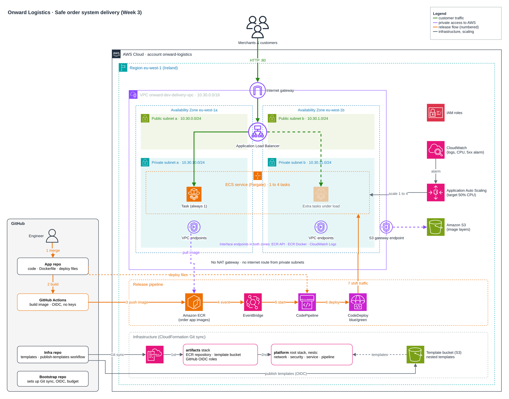

# Onward Logistics: delivering order system updates safely

Infrastructure for the week 3 lab *Delivering Order System Updates Safely for Onward Logistics*.
The order app runs as a container on ECS Fargate in private subnets with no route to the internet,
behind one public Application Load Balancer. Every merge to the app repository is released
automatically, blue/green, with no stored credentials anywhere.



## The three repositories

| Repository | What it holds |
|---|---|
| [week3-aws-lab-safe-delivery](https://github.com/ghaby27/week3-aws-lab-safe-delivery) (this one) | CloudFormation for the lab, deployed by Git sync |
| [aws-dev-associate-lab-app](https://github.com/ghaby27/aws-dev-associate-lab-app) | The app, its `Dockerfile`, the GitHub Actions release workflow and the CodeDeploy files (`deploy/`) |
| [onward-bootstrap](https://github.com/ghaby27/onward-bootstrap) | Shared setup (GitHub connection, GitHub OIDC provider, budget) and the scripts that build or remove a lab |

## How a change reaches customers

1. An engineer merges to `main` in the app repository. This is the only manual step.
2. GitHub Actions builds the image, signs in to AWS with a short-lived OIDC token and pushes the image to ECR as `<commit sha>` and `latest`.
3. ECR raises an event; the EventBridge rule `onward-dev-delivery-image-push` starts CodePipeline.
4. CodePipeline collects the image and the app repository's `deploy/` files and hands them to CodeDeploy.
5. CodeDeploy starts the new version on the green target group, moves the listener to it once the tasks are healthy, and keeps the old version for 15 minutes. It rolls back on its own if the release fails or the 5xx alarm fires, or with one click ("Stop and roll back") in the console.

## Layout

Two stacks, both kept in step with this repository by Git sync and built in this order:

| Stack | Folder | Contents |
|---|---|---|
| `onward-dev-delivery-artifacts` | `infra/artifacts/` | ECR repository (scan on push, keeps the last 10 images) and the GitHub push role for the app repository; the S3 bucket for the nested templates and the publish role for this repository. Both roles use OIDC, `main` only |
| `onward-dev-delivery-platform` | `infra/platform/` | Root stack. It nests the four stacks below and passes each one's outputs to the next |

The nested stacks, in `infra/platform/stacks/`:

| Nested stack | Contents |
|---|---|
| `network` | VPC 10.30.0.0/16 in two AZs; public subnets (load balancer) and private subnets (tasks) with **no NAT and no default route**; interface endpoints for ECR API, ECR Docker and CloudWatch Logs; S3 gateway endpoint limited to ECR's layer bucket |
| `security` | Security groups (only port 80 on the load balancer is public; tasks accept 8080 from the load balancer only and send HTTPS to the endpoints only) and IAM roles: task execution, EventBridge, pipeline, CodeDeploy. Managed policies only, no inline policies |
| `service` | Load balancer, blue and green target groups, ECS cluster, first task definition, Fargate service (1-4 tasks, CPU target tracking at 50%), log group |
| `pipeline` | EventBridge rule, CodePipeline, CodeDeploy application and blue/green deployment group, 5xx rollback alarm, artifact bucket |

`artifacts` stays a separate stack because the platform needs what it holds before it can be built: the nested templates to deploy, and an image for the service to start.

### Changing a nested stack

CloudFormation reads nested templates from S3, while Git sync deploys from this repository. The [`publish-templates`](.github/workflows/publish-templates.yml) workflow joins the two:

1. You push a change under `infra/platform/stacks/`.
2. The workflow signs in with OIDC, uploads the templates to `onward-dev-delivery-templates-<account>/<version>/` (the version is the Git tree hash of the folder, so it changes only when the templates do), and commits that version to `TemplatesVersion` in `infra/platform/deployment.yaml`.
3. Git sync sees the deployment file change and updates the root stack, which updates the nested stacks.

Changes to `infra/platform/template.yaml` or to `infra/artifacts/` deploy straight away through Git sync.

Other files: `lab.env` (lab name and stack order for the bootstrap scripts), `scripts/hooks/` (run by the bootstrap scripts: publish the templates and push the first image before the platform, empty the buckets before teardown), `docs/` (discovery report, pricing estimate), `architecture.drawio`.

## Build, rebuild and remove

With the three repositories cloned side by side:

```bash
../onward-bootstrap/deploy.sh .      # build or rebuild (about 20-25 minutes)
../onward-bootstrap/teardown.sh .    # remove the lab; idle environments cost nothing
```

`deploy.sh` enables Git sync one stack at a time. Before the platform it uploads the nested templates for the committed `TemplatesVersion` (the bucket is empty after a teardown) and makes sure ECR has an image: if not, it pushes a `build-*` tag to the app repository, which runs the release workflow. On a rebuild Git sync may report "Nothing to sync" for a layer (it remembers commits it already deployed), so the script pushes a `chore: trigger git sync for <layer>` commit that adds a timestamp line to that layer's `deployment.yaml`.

## Proving the client's checks

| Check | How |
|---|---|
| One public address, no internet route from the tasks | `AppUrl` output is the only entry point; tasks have no public IP; the private route table has only the local route and the S3 endpoint |
| A push becomes a new version with no manual steps | Change the app, merge, watch the version on the page change |
| No downtime, reversible | Keep `scripts/watch.sh` running during a release: no failed requests. Roll back with "Stop and roll back" in CodeDeploy, or let the alarm do it |
| No long-lived credentials | No access keys in either repository or in GitHub secrets; the workflow uses `role-to-assume` with OIDC |
| Scales out and in | Press **Start a CPU spike** on the page (or run `scripts/cpu-load.sh`); tasks go from 1 up to 4 and back |
| Survives a failed task or a lost AZ | Stop a task, or every task in one AZ: ECS replaces them without anyone acting. At the quiet-day size of one task, the site is down until the replacement is healthy (about a minute); with two or more tasks, the others keep serving |
| Cost | `docs/discovery-report.docx` and the [Pricing Calculator estimate](https://calculator.aws/#/estimate?id=b1d86b5dda0bf641f0ad5213322ad99ccf352dba) (about USD 94 a month, half of it the VPC endpoints) |
| Rebuild from the repositories | `teardown.sh`, then `deploy.sh` |
